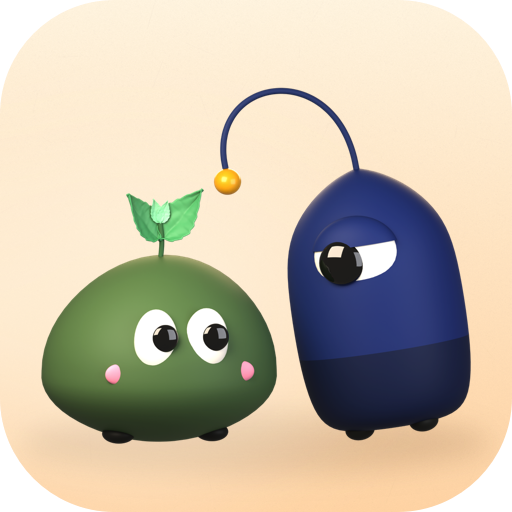
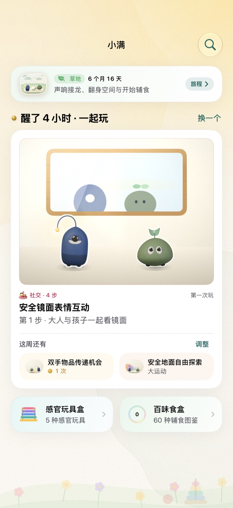
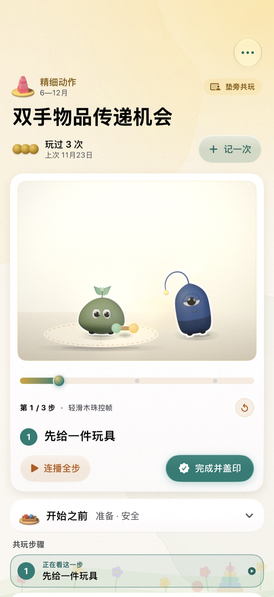
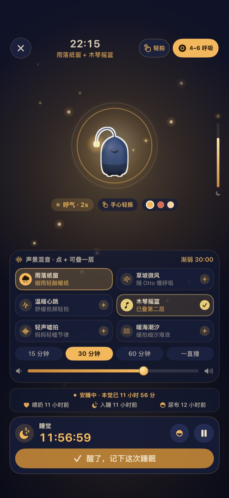
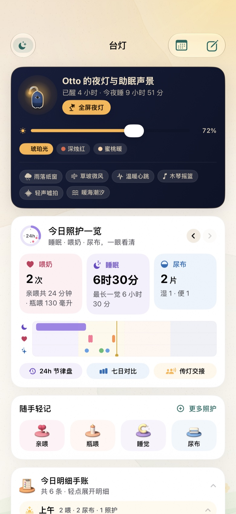
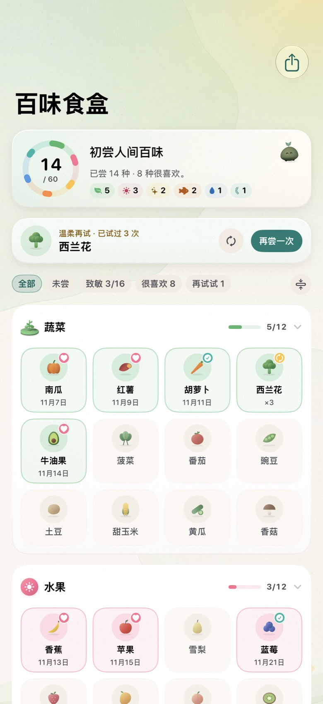
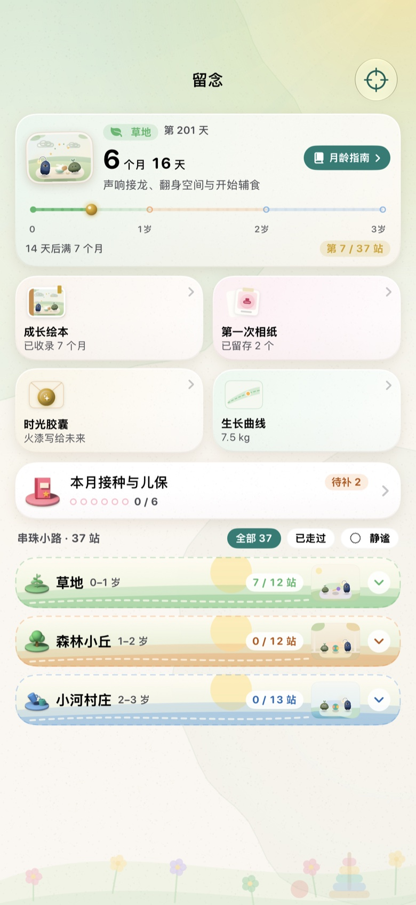

简体中文 · [English](README_EN.md)

<p align="center">
  
</p>

<h1 align="center">摸索台灯 · Moss &amp; Otto</h1>

<p align="center">
  <strong>孩子摸索，大人点灯。</strong><br>
  陪伴 0–3 岁家庭的纯离线原生养育与成长记录应用（iOS · Android）。<br>
  无账号 · 无广告 · 记录仅保存在设备本地
</p>

<p align="center">
  <a href="https://mossotto.pages.dev/">官方网站</a> ·
  <a href="https://apps.apple.com/cn/app/%E6%91%B8%E7%B4%A2%E5%8F%B0%E7%81%AF/id6825856138">App Store</a> ·
  <a href="https://github.com/mjuvdeysii/mossling/releases/latest">Android 发布版</a> ·
  <a href="https://mossotto.pages.dev/privacy.html">隐私政策</a> ·
  <a href="https://mossotto.pages.dev/terms.html">使用条款</a> ·
  <a href="https://mossotto.pages.dev/support.html">在线支持</a>
</p>

---

## 简介

**摸索台灯**不是一门育儿课程。它不布置打卡任务，不比较发育快慢，也不替大人做决定，只陪家庭把 0–36 个月的日常玩耍、照护节律与长大的痕迹安静留存下来。

| 伙伴 | 象征 | 角色 |
|---|---|---|
| **摸索 (Moss)** | 孩子 | 对世界充满好奇的小石头，头顶不断长出新芽；每天陪孩子在低矮桌面和地垫上摸索。 |
| **台灯 (Otto)** | 大人 | 不抢先手、只把光照亮的陪伴者；夜深喂睡时亮起温柔的暖光灯珠。 |

---

## 界面预览

<table>
  <tr>
    <td align="center" width="33%"><br><sub><b>今日与共玩</b></sub></td>
    <td align="center" width="33%"><br><sub><b>分步绘本与熄屏陪伴</b></sub></td>
    <td align="center" width="33%"><br><sub><b>床头夜灯与深夜照护</b></sub></td>
  </tr>
  <tr>
    <td align="center" width="33%"><br><sub><b>每日照护与单列筛选</b></sub></td>
    <td align="center" width="33%"><br><sub><b>百味食盒（辅食探索）</b></sub></td>
    <td align="center" width="33%"><br><sub><b>0–36 个月成长串珠与图谱</b></sub></td>
  </tr>
</table>

---

## 核心功能

- **每日共玩与循证微行动**：按月龄呈献 46 个家庭活动与清晰步骤图，支持立体软胶与平面绘本双画风切换、「去玩吧 · 熄屏陪伴」静心幕帘，以及 9 阶段循证微行动与家人分享卡（支持离线语音朗读）。
- **白天照护优先，深夜极简防眩光**：亲喂（支持左/右侧换边、暂停与干净舍弃）、瓶喂（精确到 5 ml）、睡眠与尿布轻点即记；日间优先展示当前计时、随手轻记与 24 小时节律泳道，点击分类卡片即可孤立查看单列明细；00:00–04:59 自动切换低眩光深夜台灯模式，配合 6 组纯离线助眠声景与锁屏实时活动。
- **早产双轨与温和发育参考**：支持设置 24–36 周出生孕周，在 24 月龄前自动双轨计算矫正月龄；内置 WHO 儿童生长标准（2006）百分位曲线、WHO MGRS 六项大运动健康宽带图谱、三态温柔观察（「亮起来了 / 正在摸索中 / 留给医生看看」），并支持一键生成 1 页可打印的儿保诊室摘要 PDF。
- **跨设备纯本地交接与隐私守护**：零账号、零服务器、零广告与零跟踪器；支持面向照顾者的无后端 URL 锚点网页交接卡、完整 JSON / CSV / Markdown 本地导出与面容 ID / 生物识别锁。

---

## 支持平台

| 平台 | 技术栈 | 当前分发方式 |
|---|---|---|
| **iOS** | SwiftUI 原生应用 · iOS 26+ · WidgetKit & App Intents | [App Store](https://apps.apple.com/cn/app/%E6%91%B8%E7%B4%A2%E5%8F%B0%E7%81%AF/id6825856138)（一次买断，无广告、无订阅） |
| **Android** | Kotlin · Jetpack Compose · Material 3 · Room | [GitHub Releases](https://github.com/mjuvdeysii/mossling/releases/latest) |

---

## 循证参考与免责声明

应用内的发展观察、生长曲线、免疫规划与健康提示整理自世界卫生组织（WHO）、联合国儿童基金会（UNICEF）、中国国家卫生健康委员会、国家疾病预防控制局、美国疾病控制与预防中心（CDC）及美国儿科学会（AAP）公开发布的指南与资料，并在应用内「内容来源」页面逐条注明出处与核对日期。

本应用仅供家庭日常养育与记录参考，不构成医疗诊断、发育评估或治疗建议。品牌与角色规范见 [docs/IP.md](docs/IP.md)，合规与法律文档见 [PRIVACY.md](PRIVACY.md)、[TERMS.md](TERMS.md)、[DISCLAIMER.md](DISCLAIMER.md) 及 [ios/Docs/](ios/Docs/)。

---

## 仓库结构

| 目录 | 说明 |
|---|---|
| `ios/` | iOS 主应用、桌面与锁屏小组件工程及单元测试（[ios/project.yml](ios/project.yml)） |
| `app/` | Android 原生应用源码与共用离线内容资产 |
| `docs/` | 官方网站静态页面、双语界面截图与角色视觉正典 |
| `licenses/` | 第三方开源许可说明 |

```bash
# iOS：生成 Xcode 工程
cd ios && xcodegen generate

# Android：本地构建 Debug APK
gradle :app:assembleDebug
```

---

## 支持与反馈

- 官方网站：https://mossotto.pages.dev/
- 问题反馈：[GitHub Issues](https://github.com/mjuvdeysii/mossling/issues)
- 支持邮箱：`lbuiuiysdeyzxl@yeah.net`
