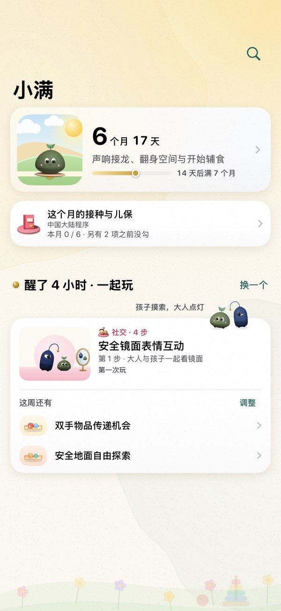
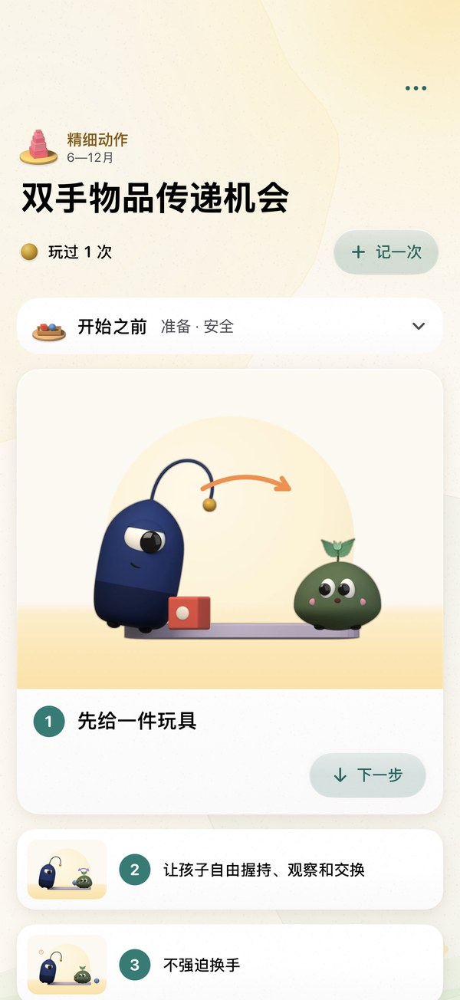
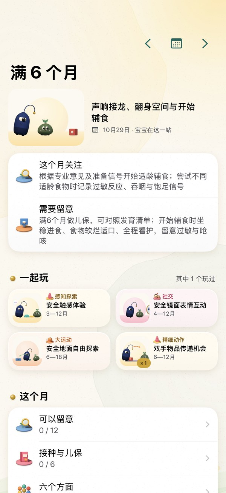
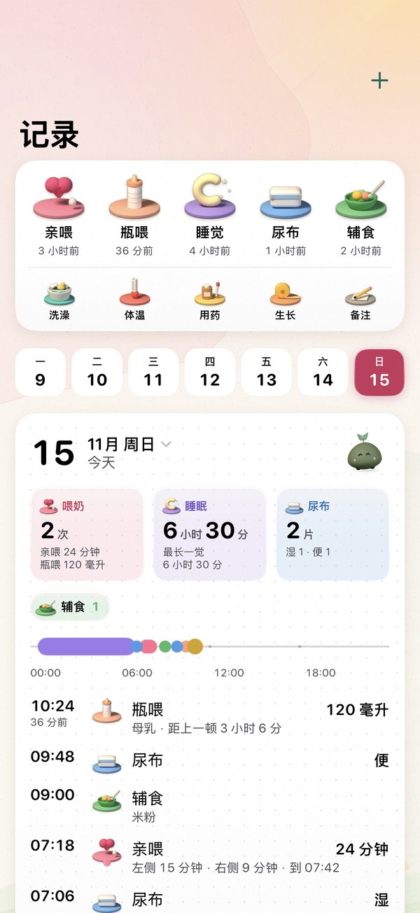
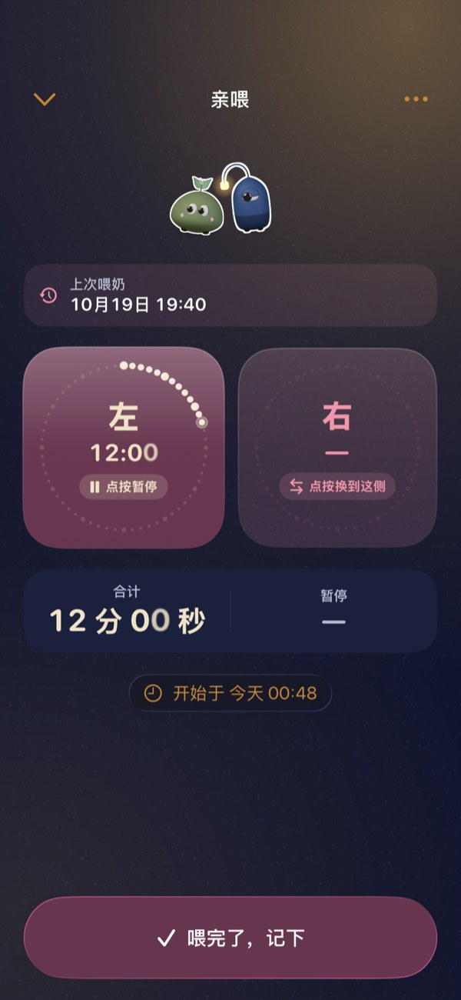
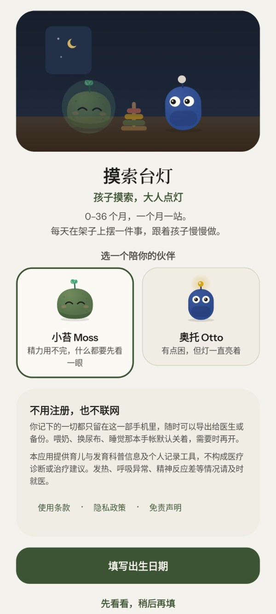
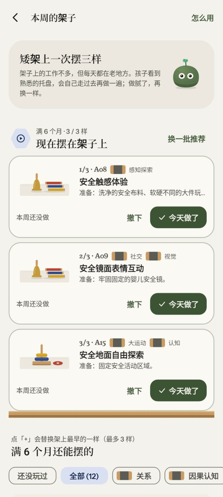
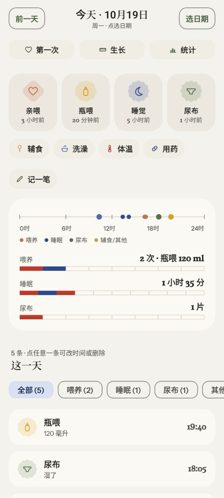
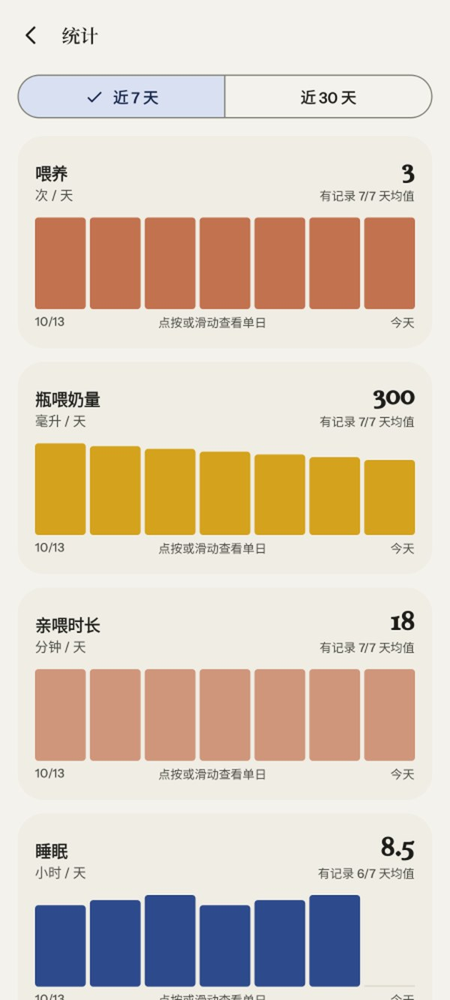
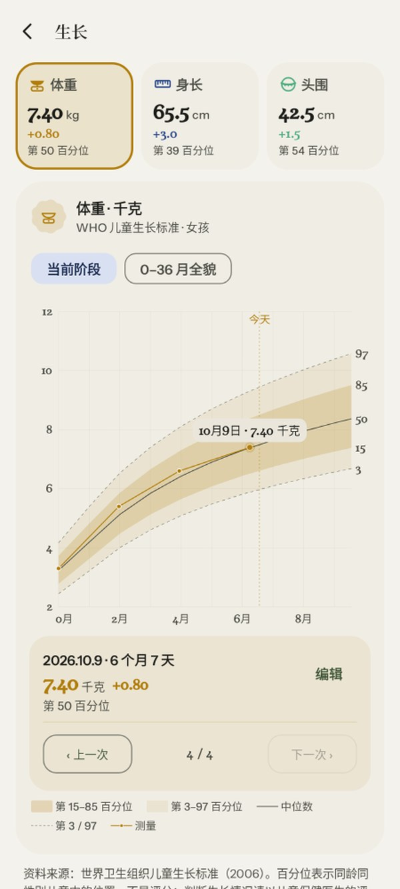

# 摸索台灯 Moss & Otto

<b>孩子摸索，大人点灯。</b> 陪 0–3 岁的孩子一起玩、一起长大，把每一天记下来。 一次买断 · 无广告 · 不需要账号 · 记录只保存在手机里

<a href="#ios-版">iOS 版</a> · <a href="#安卓版">安卓版</a> · <a href="docs/IP.md">品牌与 IP</a> · <a href="PRIVACY.md">隐私政策</a> · <a href="TERMS.md">使用条款</a> · <a href="DISCLAIMER.md">免责声明</a>

## 这是什么

摸索台灯不是育儿课。它不教大人怎么养孩子，也不给孩子打分，只陪大人和孩子一起玩、一起长大，并把长大的样子记下来。

| 名字 | 属于谁 | 含义 |
|---|---|---|
| 摸索 | 孩子 | 0–3 岁的孩子用手、用嘴、用眼睛摸索世界。Moss 的名字取自「摸索」，头上的新芽一直在长。 |
| 台灯 | 大人 | 台灯不替人走路，只把桌面照亮。Otto 头顶的金色灯珠就是这盏灯。 |

在这里做三件事：

| | 在哪里 | 不做什么 |
|---|---|---|
| **一起玩** | **今天一起玩**：每天推荐一个这个月适合的活动，第 1 步的插画一眼可见，点开就是一步步的图文、准备什么、什么时候停下；这周另有两三个备选活动，每周自动轮换 | 不布置任务，不设打卡 |
| **看他长大** | 0–36 个月，一个月一站，共 37 站；蒙氏串珠链成长地图、成长册、WHO 生长曲线、接种与儿保 | 不比较，不做发育诊断 |
| **记下来**（可选） | 亲喂、瓶喂、睡眠、尿布、辅食、体温、第一次等一点即记，计时显示在锁屏与灵动岛上；亲喂分侧时长、瓶喂奶量、睡眠统计 | 不上传，不需要账号 |

满 36 个月是最后一站，却不是终点：**故事仍在继续。**

## Moss 与 Otto

两位伙伴不说话，只用眼神和动作陪伴。Moss（摸索）是孩子的好奇心：苔绿色软石，两只眼睛，头顶一片薄荷芽，什么都想先摸一下。Otto（台灯）是大人的陪伴：深蓝色，一只大眼睛，头顶一颗金色灯珠，专注又耐心，Moss 摸到哪里，他就把灯往哪里偏一点。家长可以选任意一位作为主伙伴，两位功能完全相同。完整设定见 [docs/IP.md](docs/IP.md)。

---

## iOS 版

为 iPhone 原生构建（SwiftUI，iOS 26 及以上，液态玻璃设计语言 + 3D 哑光软胶画风），**v1.0 已上架 App Store**（一次买断，无广告、无订阅；App Store 链接待补充）。

  
  
  

  
  
  

| 截图 | 说明 |
|---|---|
| 首次打开 | 没有文字的三幕开场：Otto 的灯亮起，Moss 在灯下醒来，摸了摸套圈，转头看 Otto。约四秒，只播一次，随时可跳过；开启「减弱动态效果」时静止 |
| 首页 | 孩子满几个月几天、本月接种与儿保进度，以及核心卡片**今天一起玩**：第 1 步插画一眼可见，支持「换一个」与「这周还有」自动轮换；轻点卡片边缘的 Moss 与 Otto 三次可进入「摸索台灯的故事」 |
| 活动 | 开始之前（准备与安全）、折叠式逐步 3D 软胶插画（46 个活动、146 幅步骤图）、做的时候看什么、什么时候停下；做完最后一步自动记一次 |
| 月份 | 0–36 个月 37 站与蒙氏串珠链成长地图：每月关注与留意事项、适龄活动、可以留意清单、接种与儿保（已核对 2026 年国家免疫规划）、六个发展领域与成长册 |
| 记录（可选） | 立体贴纸一点即记，时间精确到分钟；亲喂左右侧分别计时并自动合并为一顿，支持暂停、换边与撤销；瓶喂精确到 5 毫升；支持锁屏实时活动、灵动岛、桌面小组件与「第一次」里程碑 |
| 夜灯 | 晚上自动切换为小夜灯：深蓝底、暖琥珀光晕与柔光数字，Otto 的灯珠微亮，夜间减少动态打扰 |

**隐私与合规**：完全离线、不联网、不需要账号，不含广告、统计或第三方 SDK；首次打开提供同等权重的「同意 / 不同意」确认卡（不同意仍可浏览全部育儿内容），支持应用内撤回同意、面容 ID 应用锁、iOS 数据保护与本地 JSON/CSV/Markdown 导出。CI 在模拟器测试中持续采集应用进程网络日志（`ios_network.txt`）核查零联网。

**开发**：`ios/project.yml`（XcodeGen）；CI [`.github/workflows/ios.yml`](.github/workflows/ios.yml) 运行单元测试、截图测试（含 6.9 英寸 App Store 截图产物）、无障碍审查与滚动性能测试，并在合入 `main` 时自动上传 TestFlight。设计说明见 [ios/DESIGN.md](ios/DESIGN.md)，合规对照表见 [ios/COMPLIANCE.md](ios/COMPLIANCE.md)，路线图见 [ios/ROADMAP.md](ios/ROADMAP.md)。

---

## 安卓版

适用于 Android 8.0 及以上，已更新至 **v1.5.0**（原生 Jetpack Compose + Material Design 3）。[下载最新版本](https://github.com/mjuvdeysii/mossling/releases/latest)。

  
  
  

  
  
  

| 截图 | 说明 |
|---|---|
| 欢迎页 | 孩子摸索，大人点灯；无字三镜头开场、填写出生日期或先看看 |
| 本周的架子 | 横向顺滑木质托盘展示本周自动轮换的活动，支持「还没玩过」与六大领域筛选 |
| 教具 | 46 个蒙台梭利式家庭活动、146 幅分步插画，支持全屏「跟着做」手势翻步与屏幕常亮 |
| 手帐（可选） | 亲喂分侧计时、瓶喂（精确到 5 毫升）、睡眠、尿布、体温就医提示与「第一次」里程碑；通知栏计时与桌面小组件 |
| 统计 | 喂养次数、亲喂时长、睡眠与尿布趋势，以及按类别筛选的时间线 |
| 生长曲线 | 世界卫生组织儿童生长标准（2006），支持「当前阶段 / 0–36 月全貌」切换与交互式点位检视 |

此外还有「今天」（照护状态胶囊、今日一件事）、「成长」（本月 / 地图 / 专题三段式工作台、成长册画册与时间轴双模式）与按六大领域发现的搜索页。

**隐私**：不需要账号，不收集、不上传任何数据；只在用户主动点「检查更新」时联网。

**开发**：`gradle :app:assembleDebug`（Gradle 8.9、JDK 17、Android SDK 35）。CI [`build.yml`](.github/workflows/build.yml) 运行单元测试与 Paparazzi 截图（`screens` 分支），`VERSION` 中的版本尚未发布时构建签名 APK 并发布；[`emulator.yml`](.github/workflows/emulator.yml) 在模拟器上运行关键路径测试。签名密钥来自 GitHub Secrets，不在仓库中。

---

## 内容依据

育儿内容整理自世界卫生组织、联合国儿童基金会、国家卫生健康委员会、国家疾病预防控制局、中华预防医学会、美国疾病控制与预防中心、美国儿科学会等机构公开发布的指南与资料，在应用内「内容来源」中逐项标明机构、文件名称、发布日期与核对日期。`app/src/main/assets/content.json` 为两个平台共用的内容；`who_growth.json` 由 `tools/export_who.py` 生成；iOS 插画由 `tools/picturebook.py` 生成，安卓插画由 `tools/illustrate.py` 生成。

## 制作

摸索台灯由创作者本人构思与主导，借助 AI（Anthropic 的 Claude）辅助完成产品设计、插画与代码。

## 说明

本应用陪伴家庭养育，内容仅供参考，不构成医疗诊断或治疗建议。详见《[使用条款](TERMS.md)》《[隐私政策](PRIVACY.md)》《[免责声明](DISCLAIMER.md)》。
