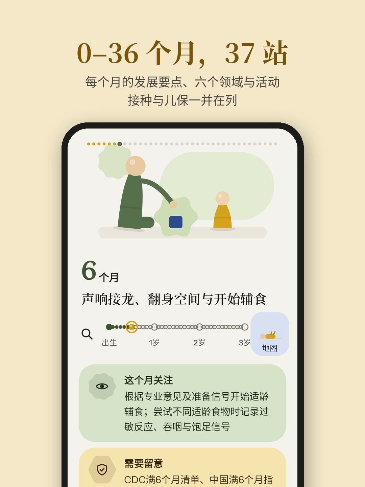
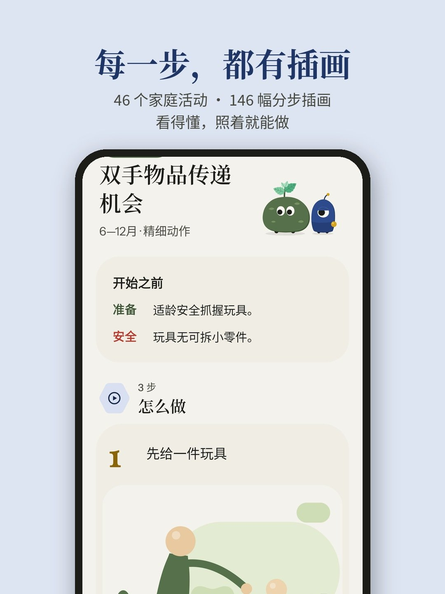
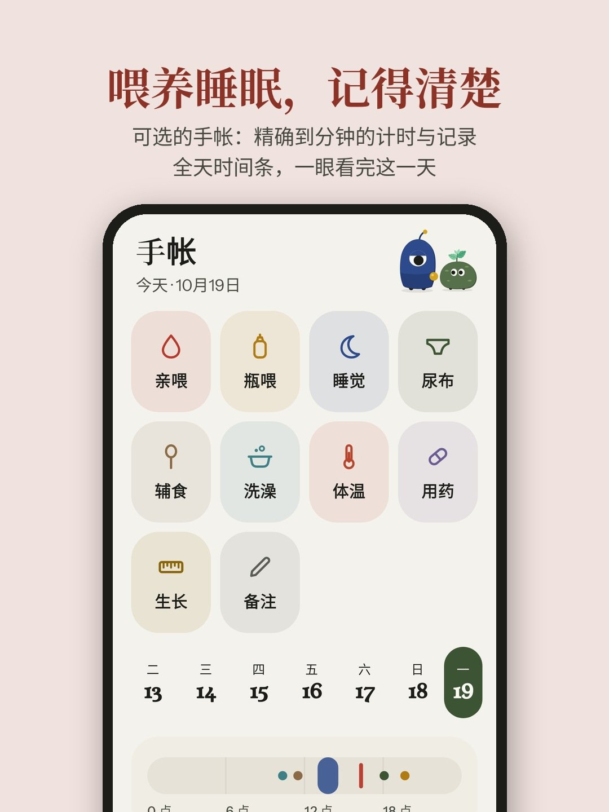
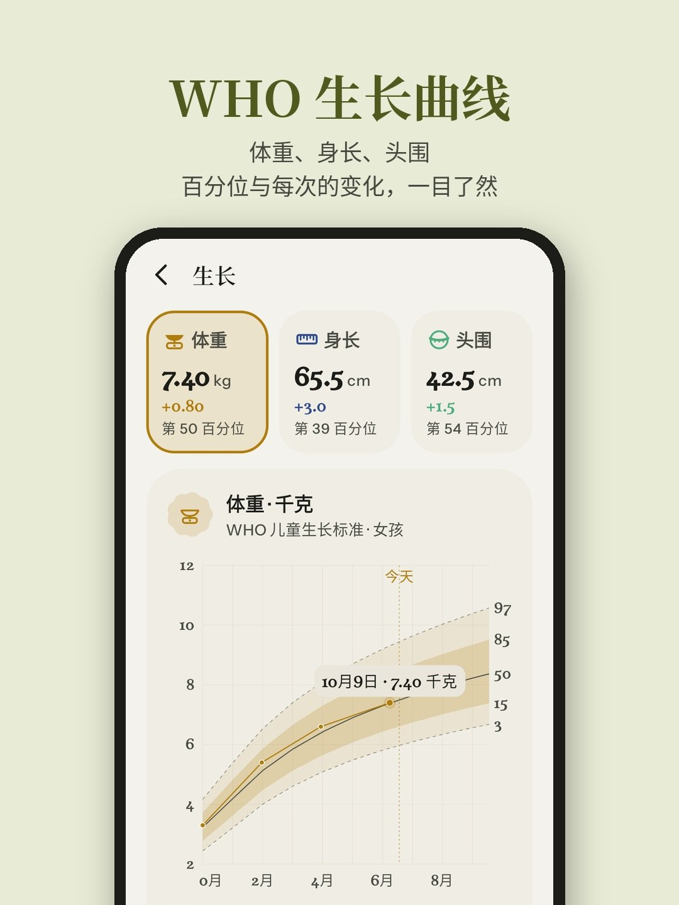

# 芽芽月历 Mossling

<b>跟着孩子，一个月一站。</b> 0–3 岁早教活动规划 · 安卓应用 · 免费 · 无广告 · 不收集任何数据

<a href="https://github.com/mjuvdeysii/mossling/releases/latest">下载最新版本</a> · <a href="PRIVACY.md">隐私政策</a> · <a href="TERMS.md">使用条款</a> · <a href="DISCLAIMER.md">免责声明</a>

  
  
  

  
  

芽芽月历（Mossling）是一款面向 0–3 岁儿童家庭的早教活动规划应用。应用以月龄为线索，将出生至满 36 个月划分为 37 站，每一站说明这个月可以留意的发展表现、适合在家一起做的活动，以及这一周可以放上架子的教具，帮助照护者在日常生活中有方向、有节奏地陪伴孩子成长。

「芽芽」是一片刚冒头的新芽，「月历」是按月展开的 37 站：每个孩子都按自己的节奏，一个月长出一点新的样子。

## 主要功能

### 今天
- 孩子满几个月几天，本月每一天以一颗串珠呈现。
- 今天的一个活动：活动编号、名称、适合月龄、第一步插画、安全要点；可换一个，也可今天不做。
- 本周的架子：每周 3–4 件活动，记录本周做过几次，新一周提示轮换。
- 下一次接种与儿童保健项目，仅在打开时显示，不推送提醒。

### 成长
- 0–36 个月串珠固定在页面顶部，点按或拖动即可翻到任意月龄。
- 每月封面插画、本月要点、活动、六个发展领域、可以留意的表现、接种与儿保、本月还要知道的事项、一天的节奏。
- 成长地图：37 站连成一条路，标明每一站的接种、儿保与记录情况；伙伴站在孩子所在的一站。
- 专题与全文搜索：睡眠、活动与屏幕；安全睡眠与防跌落；辅食与回应式喂养；口腔、屏幕与多种语言；什么时候要找医生。

### 活动
- 46 个家庭活动，覆盖语言沟通、大运动、精细动作与认知、社会情绪、生活自理与文化、健康安全六个领域。
- 每个活动包含开始之前（准备与安全）、分步插画（共 146 幅）、做的时候看什么、什么时候停下。
- 「做过」只是记录，不是评估。

### 手帐（可选，默认关闭）
- 亲喂、瓶喂、睡眠、尿布、辅食、洗澡、体温、用药与备注。
- 计时在通知栏持续显示，可暂停、换边、结束；开始与结束时间可精确到分钟。
- 按天查看全天时间条与记录，统计喂养、睡眠与尿布；每一条均可修改或删除，删除后可撤销。
- 生长：体重、身长 / 身高、头围的最新值、百分位与上次变化；曲线采用世界卫生组织儿童生长标准（2006），标出第 3–97 与第 15–85 百分位带、中位数与今天，点按测量点可查看当次数值。
- 桌面小组件：月龄、今天的活动、计时与常用记录。

### 伙伴
Moss 与 Otto 陪伴使用：Moss 是一块长着薄荷芽的绿色圆石，两只眼睛，安静地看；Otto 高高的，一只大眼睛，带着一颗金色串珠。两者一同出现，所选伙伴在前。它们会呼吸、眨眼、互相张望；孩子睡觉时，它们也睡着。

## 内容依据
内容整理自世界卫生组织、联合国儿童基金会、中国国家卫生健康委员会、中国国家疾病预防控制局、中华预防医学会、美国疾病控制与预防中心、美国儿科学会等机构公开发布的指南与资料，共列出 41 项参考文献，在「内容来源」中逐项标明机构、文件名称、发布日期与核对日期。

## 隐私与安全
- 无需账号；不收集、不上传任何个人信息；无广告、无统计分析、无第三方 SDK。
- 全部记录仅保存在设备本地，可导出、导入或一键清除；可开启应用锁。
- 仅在用户主动「检查更新」时联网，新版本可在应用内下载并安装。

## 说明
本应用提供家庭养育参考信息，不构成医疗诊断或治疗建议。详见应用内《使用条款》《隐私政策》与《免责声明》。

适用于 Android 8.0 及以上版本。

## 开发与构建

本地：`gradle :app:assembleDebug`（Gradle 8.9、JDK 17、Android SDK 35）。

CI（`.github/workflows/`）：
- `build.yml`：单元测试、Paparazzi 截图（推送到 `screens` 分支）、签名的 release APK。`VERSION` 里写的是下一个版本号：main 上若还没有对应的 `v<版本>` 发布，这次构建就作为该正式版本发布（附 `RELEASE_NOTES.md`）；其余推送只构建与测试。
- `emulator.yml`：构建成功后在安卓模拟器上运行关键路径 UI 测试、数据库迁移测试和冷启动计时。

签名密钥不在仓库中，来自 GitHub Secrets `HB_KEYSTORE_B64` 与 `HB_KEYSTORE_PASSWORD`。

## 内容

`app/src/main/assets/content.json` 直接维护；`who_growth.json` 由 `tools/export_who.py` 生成；插画由 `tools/illustrate.py` 生成；应用图标、单色图标与启动动画由 `tools/icon.py` 生成。开发计划见 [PLAN.md](PLAN.md)，商店信息见 [store/listing.md](store/listing.md)。
