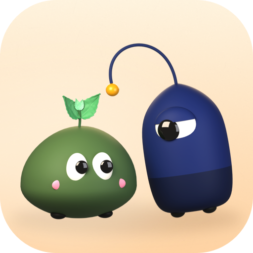
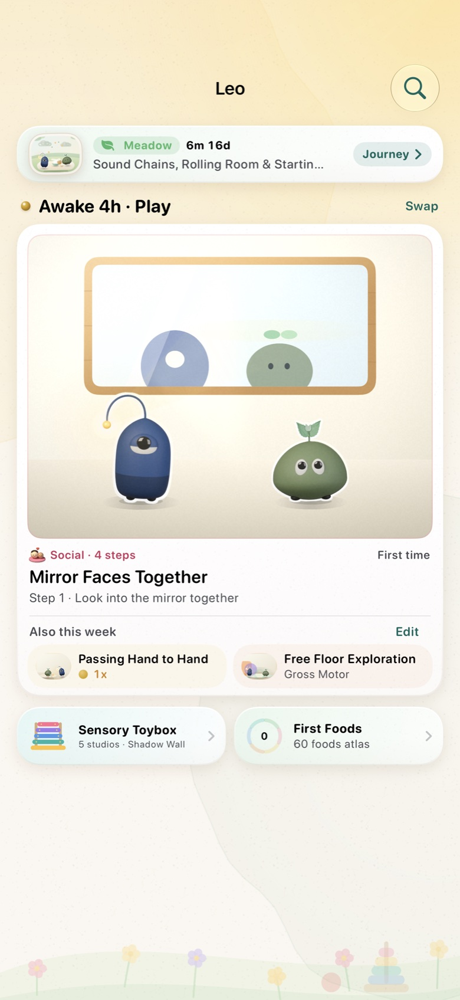
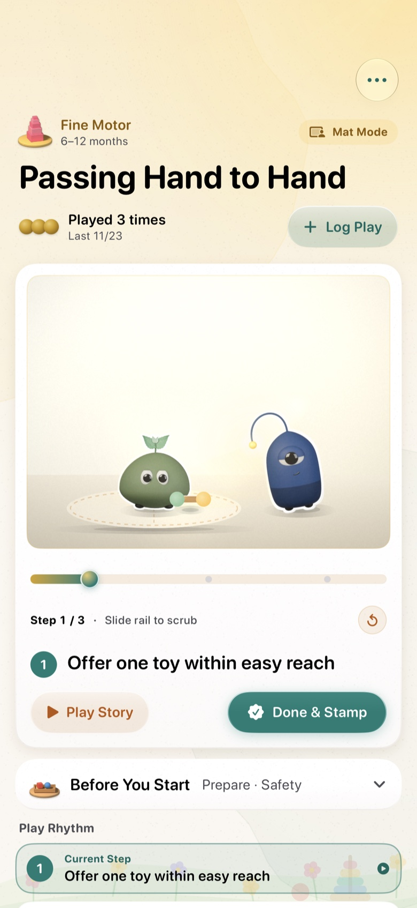
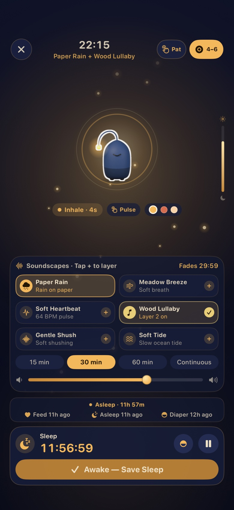
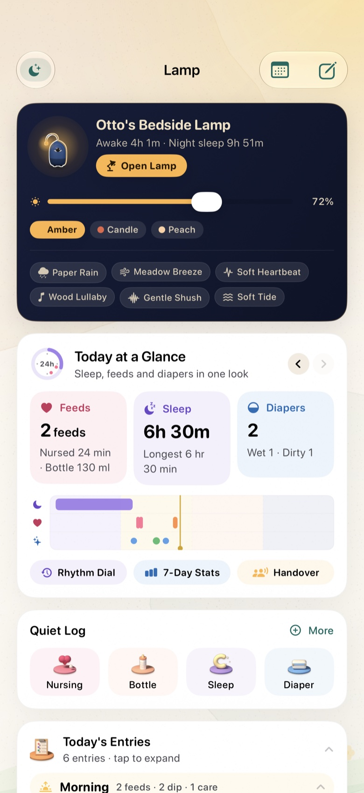
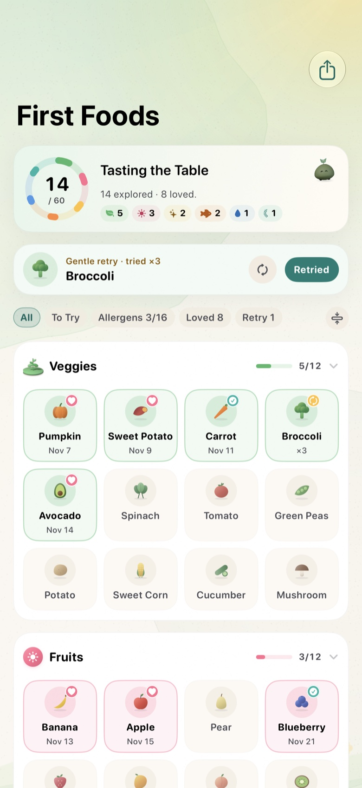
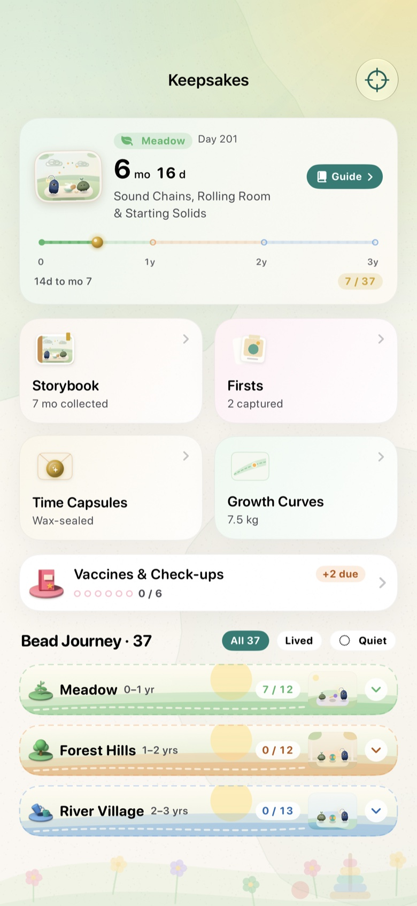

[简体中文](README.md) · English

<p align="center">
  
</p>

<h1 align="center">Moss &amp; Otto · 摸索台灯</h1>

<p align="center">
  <strong>They explore. You hold the light.</strong><br>
  An offline-first native parenting companion and calm care journal for ages 0–3 (iOS · Android).<br>
  No accounts · No ads · Data stays strictly on your device
</p>

<p align="center">
  <a href="https://mossotto.pages.dev/">Website</a> ·
  <a href="https://apps.apple.com/cn/app/%E6%91%B8%E7%B4%A2%E5%8F%B0%E7%81%AF/id6825856138">App Store</a> ·
  <a href="https://github.com/mjuvdeysii/mossling/releases/latest">Android Release</a> ·
  <a href="https://mossotto.pages.dev/privacy.html">Privacy Policy</a> ·
  <a href="https://mossotto.pages.dev/terms.html">Terms</a> ·
  <a href="https://mossotto.pages.dev/support.html">Support</a>
</p>

---

## Overview

**Moss & Otto** is not a parenting course. It assigns no streaks, never grades children against checklists, and lets parents enjoy everyday play and quiet care routines across the first three years.

| Companion | Meaning | Role |
|---|---|---|
| **Moss** | Exploration | Curious sprout-topped pebble exploring the rug alongside your child each month. |
| **Otto** | Bedside Lamp | Quiet companion holding a soft golden bulb — keeping night feeds calm and readable. |

---

## Screenshots

<table>
  <tr>
    <td align="center" width="33%"><br><sub><b>Explore &amp; Daily Play</b></sub></td>
    <td align="center" width="33%"><br><sub><b>Interactive Playbook &amp; Dim Veil</b></sub></td>
    <td align="center" width="33%"><br><sub><b>Bedside Lamp &amp; Night Care</b></sub></td>
  </tr>
  <tr>
    <td align="center" width="33%"><br><sub><b>Day Rhythm &amp; Column Filter</b></sub></td>
    <td align="center" width="33%"><br><sub><b>First Foods Atlas</b></sub></td>
    <td align="center" width="33%"><br><sub><b>0–36m Journey &amp; Growth</b></sub></td>
  </tr>
</table>

---

## Key Capabilities

- **Daily Co-Play & Micro-Intuition Cards**: 46 age-matched household activities across 0–36 months with dual 3D/2D illustration styles, a calm *"Go Play · Dim Screen"* veil, and 9-stage bilingual micro-action cards featuring offline read-aloud and plain-text family sharing.
- **Care-First Daytime Hub & Deep-Night Mode**: One-tap logging for nursing (left/right side switching, pause, clean discard), bottle volume (5 ml precision), sleep, and diapers. Daytime mode prioritizes running timers, quick log pads, and click-to-isolate ledger columns; `00:00–04:59` transitions smoothly to a low-glare deep-night view paired with 6 offline soundscapes and Lock Screen Live Activities.
- **Preterm Dual-Track Age & Evidence Tools**: Optional gestational age (24–36 weeks) applies corrected age up to 24 months across play pacing and WHO Child Growth Standards (2006) percentiles. Includes the 6-band WHO MGRS gross-motor spectrum, calm three-state observation controls (*Observed / Exploring / Ask Doctor*), and a one-page printable Pediatric Clinic Snapshot PDF.
- **Serverless Handover & Strict Local Privacy**: Zero accounts, zero servers, zero analytics SDKs. Includes URL-fragment caregiver handover cards, Face ID / biometric lock, and local JSON, CSV, and Markdown exports.

---

## Platforms

| Platform | Stack | Distribution |
|---|---|---|
| **iOS** | Native SwiftUI · iOS 26+ · WidgetKit & App Intents | [App Store](https://apps.apple.com/cn/app/%E6%91%B8%E7%B4%A2%E5%8F%B0%E7%81%AF/id6825856138) (one-time purchase, no ads or subscriptions) |
| **Android** | Kotlin · Jetpack Compose · Material 3 · Room | [GitHub Releases](https://github.com/mjuvdeysii/mossling/releases/latest) |

---

## References & Disclaimer

Developmental notes, growth percentiles, and health schedules cite public publications from the World Health Organization (WHO), UNICEF, China National Health Commission, US CDC, and the American Academy of Pediatrics (AAP), itemized inside the in-app **Content Sources** view.

Moss & Otto is a family parenting companion and personal logbook, not medical advice or a diagnostic tool. See [docs/IP.md](docs/IP.md), [PRIVACY.md](PRIVACY.md), [TERMS.md](TERMS.md), [DISCLAIMER.md](DISCLAIMER.md), and [ios/Docs/](ios/Docs/).

---

## Repository Structure

| Path | Purpose |
|---|---|
| `ios/` | Native iOS app, WidgetKit extensions, and test suites ([ios/project.yml](ios/project.yml)) |
| `app/` | Native Android app source and shared offline content assets |
| `docs/` | Official website pages, store & web showcase screenshots, and brand canon |
| `licenses/` | Third-party open-source license notices |

```bash
# iOS: generate the Xcode project
cd ios && xcodegen generate

# Android: assemble debug APK
gradle :app:assembleDebug
```

---

## Support & Contact

- Website: https://mossotto.pages.dev/
- Issue tracker: [GitHub Issues](https://github.com/mjuvdeysii/mossling/issues)
- Email: `lbuiuiysdeyzxl@yeah.net`
